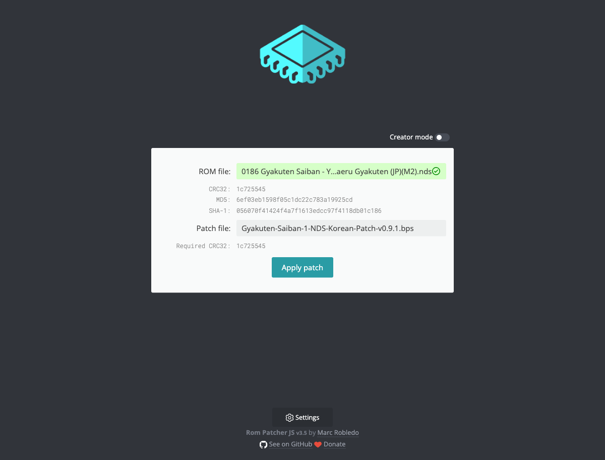

# 패치 적용 방법 — 처음 하는 분을 위한 안내

이 패치는 일본어 게임 파일을 한국어판으로 바꾸는 파일입니다. 패치 파일만으로 게임을 실행할 수는 없으며, 본인이 보유한 일본판 원본 `.nds`가 필요합니다. 0.9.0 이용자도 기존 한글 ROM 대신 <strong>일본판 원본에 0.9.1을 적용</strong>합니다.

## 1. 준비물

- Nintendo DS 일본판 《역전재판 소생하는 역전》의 원본 `.nds`
- [0.9.1 패치 ZIP](https://github.com/lf-idonotknow/Gyakuten-Saiban-1-NDS-Korean-Patch/releases/download/v0.9.1/Gyakuten-Saiban-1-NDS-Korean-Patch-v0.9.1.zip)
- 컴퓨터의 Chrome, Edge, Safari 등 웹 브라우저

지원 원본은 <strong>일본판 / 게임 코드 AGYJ / 리비전 0 / 67,108,864바이트</strong>입니다.

| 원본 확인 항목 | 값 |
|---|---|
| CRC32 | `1C725545` |
| SHA-1 | `056070f41424f4a7f1613edcc97f4118db01c186` |
| SHA-256 | `4640d5053a09eda925ac2452a32d7017a437956c6e039975db26b70f55121de0` |

확인값은 같은 파일인지 확인하는 값입니다. 아래 패치 화면에서 CRC32와 SHA-1을 확인할 수 있으므로 터미널 명령을 몰라도 적용할 수 있습니다. 영문 대소문자는 달라도 됩니다.

## 2. 받은 ZIP의 압축 풀기

1. 위의 <strong>0.9.1 패치 ZIP</strong> 링크를 누릅니다. 릴리스 화면에서 받는다면 <strong>Assets</strong>의 `Gyakuten-Saiban-1-NDS-Korean-Patch-v0.9.1.zip`을 선택합니다. `Source code (zip)`은 받지 않습니다.
2. Windows에서는 받은 ZIP을 마우스 오른쪽 버튼으로 누르고 <strong>모두 압축 풀기</strong>를 선택합니다. macOS에서는 ZIP을 두 번 클릭합니다.
3. 압축을 푼 폴더에서 <strong>`Gyakuten-Saiban-1-NDS-Korean-Patch-v0.9.1.bps`</strong>가 있는지 확인합니다. 다음 단계에서 선택할 파일은 ZIP이 아니라 이 <strong>`.bps`</strong>입니다.
4. 원본 `.nds`와 기존 세이브는 별도로 보관합니다. 작업하기 편하도록 원본 복사본과 `.bps`를 같은 폴더에 두어도 됩니다.

## 3. 패치 적용하기

1. <strong>[Rom Patcher JS 열기](https://www.marcrobledo.com/RomPatcher.js/)</strong>를 누릅니다. 아래 버튼 이름은 영어 화면 기준입니다.
2. <strong>ROM file:</strong> 옆의 파일 선택 버튼을 누릅니다.
3. 본인이 보유한 <strong>일본판 원본 `.nds`</strong>를 선택합니다. `.bps`나 ZIP을 넣는 칸이 아닙니다.
4. 계산이 끝나면 <strong>CRC32가 `1C725545`</strong>, <strong>SHA-1이 `056070f41424f4a7f1613edcc97f4118db01c186`</strong>인지 확인합니다. 값이 다르면 원본 판본을 확인해 주세요.
5. <strong>Patch file:</strong> 옆의 파일 선택 버튼을 누릅니다.
6. ZIP에서 꺼낸 <strong>`Gyakuten-Saiban-1-NDS-Korean-Patch-v0.9.1.bps`</strong>를 선택합니다.
7. 화면의 <strong>Required CRC32</strong>도 `1C725545`이고 <strong>Apply patch</strong> 버튼을 누를 수 있는지 확인합니다. <strong>Settings → Fix ROM checksum</strong>은 꺼 둡니다. 처음 접속했을 때는 기본값으로 꺼져 있습니다.
8. <strong>Apply patch</strong>를 누르고 완료될 때까지 기다립니다. 새 `.nds` 파일이 다운로드되며, 저장 위치를 묻는다면 원하는 폴더를 선택합니다.

원본과 0.9.1 패치를 모두 선택한 실제 화면입니다. 위쪽 CRC32와 아래쪽 Required CRC32가 같습니다. 원본 파일명은 달라도 확인값이 같으면 됩니다.

## 4. 결과 파일 확인하기

패치된 새 `.nds`는 <strong>134,217,728바이트 (128MiB)</strong>입니다. 원본은 64MiB이므로 결과 파일이 두 배 크기가 되는 것이 정상입니다.

확인하려면 Rom Patcher JS의 <strong>ROM file:</strong>에서 방금 생성된 새 `.nds`를 선택합니다. 확인을 위해 선택하는 것만으로 패치가 다시 적용되지는 않습니다.

| 패치 적용 후 확인 항목 | 값 |
|---|---|
| CRC32 | `A5523F95` |
| SHA-1 | `b107e22e5dea329c23b9c7f7efd8e588f9dd3e76` |
| SHA-256 | `084dd8d26a826c4e96ecc12d448c16373927045d87391c24c682de2abd3069a0` |

SHA-256까지 확인하려면 Windows PowerShell에서 `Get-FileHash -Algorithm SHA256 -LiteralPath "확인할 파일.nds"`를 사용하거나, macOS 터미널에서 `shasum -a 256 `을 입력한 뒤 파일을 끌어 넣고 Return 키를 누르면 됩니다. `확인할 파일.nds`는 실제 검사할 파일명으로 바꿉니다.

## 5. 게임 실행하기

<strong>melonDS:</strong> 방금 만든 새 `.nds`를 게임 파일로 엽니다. `.bps`나 ZIP을 게임으로 여는 것이 아닙니다.

<strong>닌텐도 DS 실기:</strong> 새 `.nds`를 microSD의 게임 폴더에 복사하고, 사용 중인 플래시카드의 게임 목록에서 선택합니다.

기존 세이브를 사용할 때는 먼저 사본을 보관합니다. 실행 환경이 ROM과 세이브의 이름을 맞추도록 요구한다면 확장자를 뺀 기본 이름을 같게 합니다. 예를 들어 `게임이름.nds`와 `게임이름.sav`처럼 맞춥니다. 정확한 저장 확장자와 폴더는 해당 플래시카드·에뮬레이터의 규칙을 따릅니다.

## 버튼이 눌리지 않거나 오류가 난다면

- <strong>패치 파일이 보이지 않음:</strong> ZIP을 모두 풀었는지 확인하고 `.bps` 파일을 선택합니다.
- <strong>원본 확인값이 다름:</strong> 위의 일본판 원본 판본인지 확인합니다. 이미 패치한 ROM에 다시 적용하지 않습니다.
- <strong>Apply patch를 누를 수 없음:</strong> 두 파일을 모두 선택하고 계산이 끝날 때까지 기다립니다.
- <strong>결과가 다름:</strong> Settings의 Fix ROM checksum이 꺼져 있는지 확인하고, 보관한 원본에서 다시 적용합니다.
- <strong>문제가 계속됨:</strong> [오류 제보](https://github.com/lf-idonotknow/Gyakuten-Saiban-1-NDS-Korean-Patch/issues/new/choose)에 패치 버전, 사용 환경, 발생 장면과 화면 사진을 남겨 주세요.
